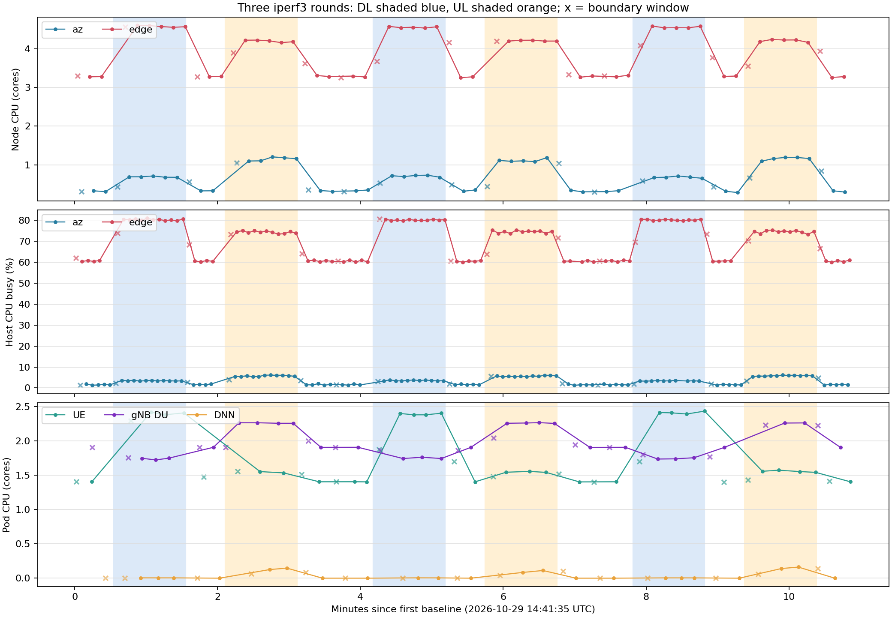

# RAN iperf3 三輪 CPU／RAM 採樣

## 目的與環境

- 日期：2026-10-29 14:41:35–14:52:44 UTC（台灣時間 22:41:35–22:52:44）。
- 拓樸：RKE 裸機叢集，`rfsim`；1 個 UE、1 個 slice、3 輪。UE、gNB CU／DU 位於 `edge` (`192.168.1.68`)，DNN 位於 `az` (`192.168.1.240`)；Pod 名稱與 UID 見 [pods.tsv](pods.tsv)。
- 部署：`POD_PROBE=1 ./script/deploy.sh zoomv3 1 1 rfsim 1 1 1`。
- 流量與採樣：`BASELINE_SECONDS=30 RECOVERY_SECONDS=30 IPERF_SECONDS=60 SAMPLE_INTERVAL=5`；每輪依序 baseline、DL、DL 恢復、UL、UL 恢復，最後再採集 15 秒接收晚到樣本。
- git hash: 同本文件init的git hash。使用修正後的 `start_iperf_cpu_test.sh` 與 `summarize_iperf_cpu.py`。
## 原始資料與圖

| 檔案 | 內容 |
| --- | --- |
| [samples.jsonl.gz](samples.jsonl.gz) | 129 次 receiver 快照的無損壓縮原始資料；解壓後 SHA-256：`2c191ba5fe148d0d575db802db4d63be1f621defda4f2caa0c941ee6501ed772` |
| [phases.jsonl](phases.jsonl) | 3 輪共 15 個負載／恢復階段及 1 段最後採集期的起訖時間 |
| [cpu-memory-series.tsv](cpu-memory-series.tsv) | 按來源時間歸入階段的 CPU／RAM 時間序列；`window_note` 標示跨階段的 CPU 差值 |
| [cpu-memory-summary.tsv](cpu-memory-summary.tsv) | 每輪與合併三輪的 `source_n`、`clean_n`、平均、最小及最大值 |
| [cpu-time.png](cpu-time.png) | `az`／`edge` node cores、主機 busy%、UE／gNB DU／DNN Pod cores 的時間圖；`×` 表示差值視窗跨越階段邊界 |
| [plot_cpu.py](plot_cpu.py) | 由 `phases.jsonl` 與 `cpu-memory-series.tsv` 重畫 `cpu-time.png`；執行 `python3 plot_cpu.py`，需安裝 matplotlib |
| [ping.1.txt](ping.1.txt)；`throughput.{DL,UL}.1.{1,2,3}.txt` | UE tunnel ping 與六次 iperf3 完整輸出；各次流量的精確結束時間另見相應 `.ended_at` 檔 |

129 次快照都有觀測值且 `missing=[]`；這只代表 receiver 所要求的核心 node 指標可用，不保證每個 Pod 指標在每次快照都更新。摘要會對同一對象、指標與來源時間全域去重，再依 `phases.jsonl` 的時間區間歸屬。共 1506 筆時間序列資料，其中 240 筆 CPU 差值視窗跨越階段起點，保留於時間序列但不納入 `clean_n` 的平均。約 300 筆時間序列資料是在所屬階段結束後才被快照查到；用查詢時的階段標籤分類會錯置或漏算這些資料。

## 流量結果

UE tunnel 位址為 `12.1.1.2`，六份 iperf3 輸出的 `local` 均為 `12.1.1.2`，沒有落到 UE Pod IP。DL 採 reverse mode，UL 由 UE 送往 DNN。下列吞吐量為 iperf3 接收端的 60 秒平均；重傳數取 sender 摘要。

| 輪次 | DL (Mbit/s) | DL 重傳 | UL (Mbit/s) | UL 重傳 |
| ---: | ---: | ---: | ---: | ---: |
| 1 | 155 | 561 | 98.6 | 340 |
| 2 | 152 | 391 | 98.7 | 117 |
| 3 | 156 | 511 | 98.1 | 1335 |

第三輪 UL 重傳較高，分析 CPU 或吞吐量差異時須連同原始 iperf3 紀錄檢查。此處的 iperf3 吞吐量是特定拓樸與流量條件下的量測結果，不等同無線 uplink capacity。

## CPU／RAM 判讀

下表是各輪階段內排除跨邊界差值後的平均。Node cores 來自 kubelet `/metrics/resource`；主機 busy% 來自 worker 的 `/proc/stat`，兩者單位不同，也不能與 Pod cores 相加。完整來源樣本數、數值範圍及其他 Pod／container 指標見 [cpu-memory-summary.tsv](cpu-memory-summary.tsv)。

| 指標 | 階段 | 第 1 輪 | 第 2 輪 | 第 3 輪 |
| --- | --- | ---: | ---: | ---: |
| `edge` node CPU (cores) | baseline / DL / UL | 3.281 / 4.584 / 4.202 | 3.285 / 4.561 / 4.211 | 3.298 / 4.563 / 4.213 |
| `az` node CPU (cores) | baseline / DL / UL | 0.317 / 0.690 / 1.150 | 0.338 / 0.710 / 1.115 | 0.319 / 0.679 / 1.160 |
| `edge` host CPU busy (%) | baseline / DL / UL | 60.634 / 80.353 / 74.380 | 60.550 / 80.192 / 74.627 | 60.662 / 80.239 / 74.614 |
| UE Pod CPU (cores) | baseline / DL / UL | 1.404 / 2.402 / 1.543 | 1.404 / 2.390 / 1.547 | 1.404 / 2.412 / 1.556 |
| gNB DU Pod CPU (cores) | baseline / DL / UL | 1.907 / 1.739 / 2.260 | 1.907 / 1.749 / 2.259 | 1.906 / 1.743 / 2.261 |

三輪都顯示相同方向的階段變化：DL 時 UE Pod 與 `edge` node CPU 增加；UL 時 gNB DU 與 `az` node CPU 增加。`edge` node CPU 在 DL 與 UL 各有 6 筆獨立來源時間、其中 5 筆未跨邊界；30 秒 baseline 各有 3 筆來源時間、其中 2 筆未跨邊界。`edge` 主機 busy% 在 DL／UL 大多有 12 筆來源時間、其中 11 筆未跨邊界。個別 Pod 的 kubelet 來源更新較稀疏，例如 UE Pod 在每段 60 秒 DL 有 4–5 筆來源時間、其中 3–4 筆未跨邊界。

Node memory working set 的變化小於 CPU：`edge` 三輪 baseline 平均約 6581.730–6584.139 MiB，DL 約 6585.324–6586.900 MiB，UL 約 6589.516–6592.564 MiB。工作集合數值受系統與其他 Pod 影響，不能單獨歸因於這次 iperf3。

這三輪在同一部署及 UE/DNN session 上依固定順序執行，沒有隨機化流量順序或隔離其他工作負載。結果支持「在此拓樸下，探針可穩定量到與 DL／UL 同步的 CPU 變化」；要把變化量當成通用負載模型，還需更換流量強度、重複部署與控制背景負載。
